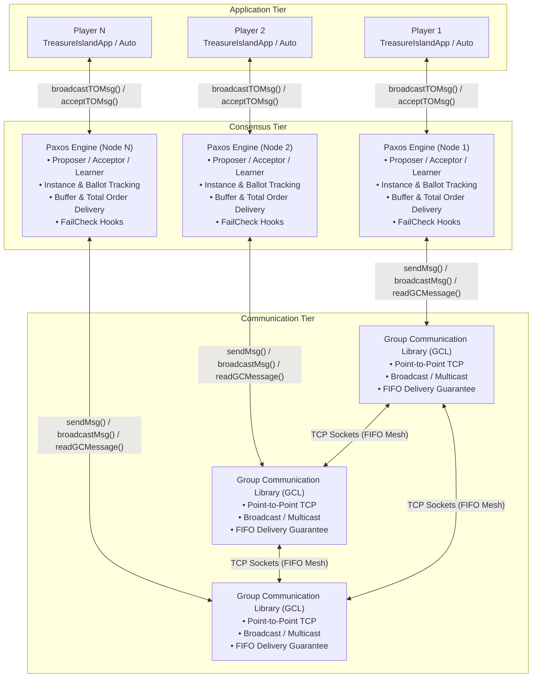

# COMP 512: Distributed Systems (Fall 2026)

McGill University — School of Computer Science  
**Instructor**: Prof. Bettina Kemme  
**Team Members**:
- **Nathan Hu** — 261147733
- **Project Partner**

---

## 📌 Repository Overview & Milestones

This repository contains the complete implementation, starter materials, test suites, and documentation for **COMP 512: Distributed Systems**.

| Milestone | Topic | Status | Due Date | Source Directory | Reference Starter |
| :--- | :--- | :--- | :--- | :--- | :--- |
| **PA2** | **Total Order Using Paxos (Treasure Island Game)** | 🚀 **Active** | **November 2, 2026** | [`pa2/`](file:///Users/nathanhu/downloads/COMP%20512/pa2) | [`p2-students/`](file:///Users/nathanhu/downloads/COMP%20512/p2-students) |
| **PA1** | **Distributed Travel Reservation System (RMI & TCP)** | ✅ **Completed** | **October 5, 2026** | [`pa1/`](file:///Users/nathanhu/downloads/COMP%20512/pa1) | [`pa1-students/`](file:///Users/nathanhu/downloads/COMP%20512/pa1-students) |

---

## 🏝 Active Milestone: Programming Assignment 2 (PA2)

### Total Order Using Paxos in "Treasure Island"
In PA2, you develop a fault-tolerant **Paxos consensus module** over a Group Communication Library (GCL) to provide **total order delivery** of player moves in a distributed multi-player game, **Treasure Island**.



### Core Requirements & Invariants
1. **Academic Honesty / AI Restriction**: Question 1 (Implementation) forbids any AI assistance for code development. The project report requires a signed No-AI declaration.
2. **Package Visibility**: `Paxos.java` in package `comp512st.paxos` is the **only public class**. Only `Paxos(...)`, `broadcastTOMsg`, `acceptTOMsg`, and `shutdownPaxos` are public methods. Helper and message classes must be package-private.
3. **IPC Restriction**: ALL inter-process communication must use GCL (`comp512.gcl.GCL`). No RMI, raw sockets, or NIO channels.
4. **Update-Anywhere Model**: Every node proposes moves from its local player (no primary copy redelegation).
5. **No Dropped Moves**: If a process fails to become leader for turn $k$, it retries pushing its move in turn $k+1$ until committed.
6. **Blocking Semantics**:
   - `broadcastTOMsg(Object val)` blocks until a majority accepts the move. Does not wait for all processes, but ensures all correct processes eventually receive it.
   - `acceptTOMsg()` blocks if no message is available, buffering out-of-order messages and delivering them in total order.
7. **Failure Points Instrumentation**: Instrumented with 5 failure points (`RECEIVEPROPOSE`, `AFTERSENDVOTE`, `AFTERSENDPROPOSE`, `AFTERBECOMINGLEADER`, `AFTERVALUEACCEPT`).

### Building and Running PA2

#### 1. Compile PA2
```bash
cd pa2
./build_tiapp.sh
```

#### 2. Run Interactive Game (Manual Play)
Edit `pa2/comp512st/tiapp/run_tiapp.sh` to configure group number, server hostnames, and ports:
```bash
# Terminal 1 (Player 1)
./pa2/comp512st/tiapp/run_tiapp.sh 1

# Terminal 2 (Player 2)
./pa2/comp512st/tiapp/run_tiapp.sh 2
```

#### 3. Run Automated Stress Tester (Performance Analysis)
Edit `pa2/comp512st/tests/run_tiapp_auto.sh` to configure `maxmoves`, `interval`, `randseed`, and `failmode_N`:
```bash
./pa2/comp512st/tests/run_tiapp_auto.sh
```

#### 4. Automated Verification & Packaging
```bash
# Run PA2 verification (visibility, compilation, GCL invariants, fail points)
python3 .agents/skills/comp512-verifier/scripts/verify_pa2.py

# Package clean submission ZIP
python3 .agents/skills/submission-packager/scripts/package_submission.py --assignment PA2
```

---

## ✈️ Completed Milestone: Programming Assignment 1 (PA1)

### Distributed Travel Reservation System (RMI & TCP Sockets)
* **Part 1.1: RMI Distribution**: 3 backend ResourceManagers (`Flights`, `Cars`, `Rooms`), centralized Middleware customer tracking (Option C), and 2-phase atomic bundle reservations.
* **Part 1.2: TCP Sockets Distribution & Asynchronous Concurrency**: Blocking client, non-blocking Middleware worker thread dispatcher, concurrent backend ResourceManagers with synchronized storage, and generic message wrapping proxy.

#### Compiling PA1
```bash
make -C pa1/Server
make -C pa1/Client
```

#### Running PA1 Tests
```bash
python3 .agents/skills/comp512-verifier/scripts/check_course_adherence.py
python3 .agents/skills/comp512-verifier/scripts/verify_pa1.py
python3 .agents/skills/comp512-verifier/scripts/test_edge_cases.py
python3 .agents/skills/comp512-verifier/scripts/test_distributed_system.py
```

---

## 📂 Repository Directory Layout

```
COMP 512/
├── pa2/                                # Active PA2 workspace (Treasure Island & Paxos)
│   ├── build_tiapp.sh                  # PA2 compilation script
│   ├── comp512p2.jar                   # Group Communication Library (GCL) & Treasure Island binaries
│   └── comp512st/
│       ├── paxos/
│       │   └── Paxos.java              # Total order Paxos consensus module (ONLY public class)
│       ├── tiapp/
│       │   ├── TreasureIslandApp.java  # Interactive game application
│       │   └── run_tiapp.sh            # Manual game launcher
│       └── tests/
│           ├── TreasureIslandAppAuto.java # Automated stress tester
│           └── run_tiapp_auto.sh       # Automated tester script
├── p2-students/                        # Pristine PA2 starter distribution & docs
│   ├── comp512p2/                      # Starter code directory
│   ├── comp512p2.tar.gz                # Starter code archive
│   ├── p2docs/                         # Project specifications & manuals
│   └── p2docs.tar.gz                   # Documentation archive
├── pa1/                                # Completed PA1 workspace (Travel Reservation System)
│   ├── Server/                         # Backend ResourceManagers & Middleware (RMI & TCP)
│   ├── Client/                         # Interactive & automated client
│   └── Makefile                        # Build orchestration
├── pa1-students/                       # Pristine PA1 starter distribution & docs
├── Course Content/                     # Authoritative course slides & project documents
│   ├── Slides/                         # Lecture slides (IPC, Network Stack, RMI, Paxos, Replication)
│   └── Project Docs/                   # PA1 & PA2 official specification PDFs
├── .agents/skills/                     # Automated developer skills
│   ├── comp512-verifier/               # PA1 & PA2 test suites and verification scripts
│   ├── course-content-monitor/         # Continuous course content detector & manifest tracker
│   └── submission-packager/            # Clean assignment packaging utility
└── gemini.md                           # Living distributed systems repository guide
```

---

## 📚 Living Project Guide

For complete architectural details, protocol workflows, Paxos consensus diagrams, failure point specifications, and lecture notes, consult [`gemini.md`](file:///Users/nathanhu/downloads/COMP%20512/gemini.md).
